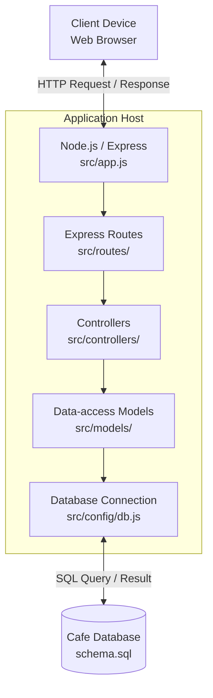
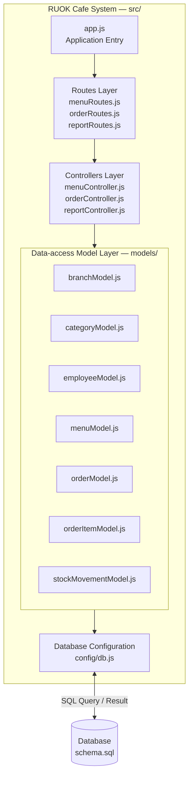

# wk11-architecture.md
# RUOK Cafe System — Architectur

## 1. Physical View (Deployment View)

แผนภาพนี้แสดงการเชื่อมต่อระหว่างเครื่องผู้ใช้ แอปพลิเคชัน Node.js/Express และฐานข้อมูลของระบบ RUOK Cafe System โดยอิงจากโครงสร้าง repository ที่เห็นในโปรเจกต์ ได้แก่ `src/app.js`, `src/config/db.js` และไฟล์ `schema.sql`

- **Client Device:** ผู้ใช้เข้าถึงระบบผ่าน Web Browser
- **Application Host:** รันแอป Node.js/Express และมี Routes, Controllers, Models และการตั้งค่าการเชื่อมต่อฐานข้อมูลอยู่ใน repository เดียวกัน
- **Database:** จัดเก็บข้อมูลตาม schema ที่กำหนดใน `schema.sql`
- ภาพนี้เป็น logical deployment overview ไม่ได้ยืนยันว่าแอปและฐานข้อมูลอยู่คนละเครื่อง หากใช้งานบนเครื่องเดียว ให้ถือว่าองค์ประกอบเหล่านี้ทำงานบนเครื่องเดียวกันได้

## 2. Development View (Component / Module Decomposition)

เลือกแนวทาง **(ก) — แยก Data-access Model แล้ว** เพราะ repository มีไฟล์ Model แยกจาก Controller และใน `src/models/branchModel.js` มีการ import `../config/db` และเรียก `db.query(...)` ภายใน Model โดยตรง

อย่างไรก็ตาม จากโครงสร้างไฟล์ที่เห็น **ไม่พบ `Order.js` ซึ่งเป็น Domain Class ตามตัวอย่างในโจทย์ wk11** ดังนั้นแผนภาพนี้จะแสดงเฉพาะไฟล์และส่วนประกอบที่ตรวจสอบพบจริง ไม่เพิ่มกล่อง `Order.js` ขึ้นมาเอง

### หน้าที่ของแต่ละส่วน

- **`app.js`:** จุดเริ่มต้น/การตั้งค่าแอปพลิเคชันตามชื่อไฟล์ใน repository
- **`src/routes/`:** กำหนดเส้นทางคำขอ เช่น `menuRoutes.js`, `orderRoutes.js` และ `reportRoutes.js`
- **`src/controllers/`:** จัดการการทำงานของคำขอ เช่น `menuController.js`, `orderController.js` และ `reportController.js`
- **`src/models/`:** แยกฟังก์ชันเข้าถึงข้อมูลไว้ตามประเภทข้อมูล ได้แก่ Branch, Category, Employee, Menu, Order, Order Item และ Stock Movement
- **`src/config/db.js`:** จัดเตรียมการเชื่อมต่อฐานข้อมูล ซึ่ง Model ใช้เรียกคำสั่ง SQL
- **`schema.sql`:** ไฟล์ schema ที่ใช้ประกอบการตรวจสอบโครงสร้างฐานข้อมูล

## 3. สรุปสถาปัตยกรรม

จากโครงสร้าง repository ที่ตรวจสอบได้ ระบบ RUOK Cafe System จัดโค้ดเป็นแอปพลิเคชัน Node.js/Express ภายใน repository เดียว และแบ่งความรับผิดชอบเป็น Routes, Controllers, Data-access Models และ Database Configuration จึงอธิบายรูปแบบการออกแบบได้ว่าเป็น **Monolithic Architecture ที่จัดโครงสร้างภายในแบบ Layered Architecture**: เป็น monolith เพราะองค์ประกอบฝั่งแอปพลิเคชันอยู่ในโปรเจกต์เดียว ไม่ได้แยกเป็นหลาย service ที่ deploy แยกกัน และเป็น layered เพราะแยกไฟล์ routing, controller, data access และ database configuration ออกจากกัน แนวทางนี้เหมาะกับโครงงานขนาดเล็กเพราะเข้าใจและดูแลรักษาง่ายกว่าการเพิ่มความซับซ้อนของ Microservices

จากภาพหน้าจอ Model แยกการเรียกฐานข้อมูลไว้ในไฟล์ เช่น `branchModel.js` ซึ่ง import `../config/db` และเรียก `db.query(...)` จึงเลือก Development View แบบ **(ก)** ในแง่ที่มี Data-access Model แยกไฟล์ อย่างไรก็ตาม ภาพหน้าจอที่มีอยู่ยังไม่แสดง `Order.js` ซึ่งโจทย์ wk11 ระบุว่าเป็น Domain Class ที่ควรมีตามงานสัปดาห์ 6 จึงควรตรวจสอบไฟล์ดังกล่าวและเพิ่ม/แก้ไขให้สอดคล้องกับสถานะจริงก่อนส่ง โดยไม่วาดให้ดูเหมือนมีไฟล์ที่ไม่มีอยู่จริง
