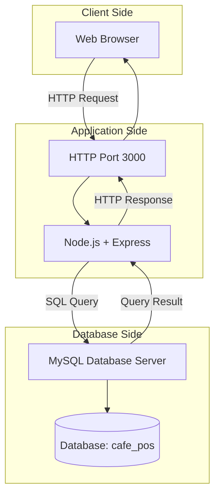
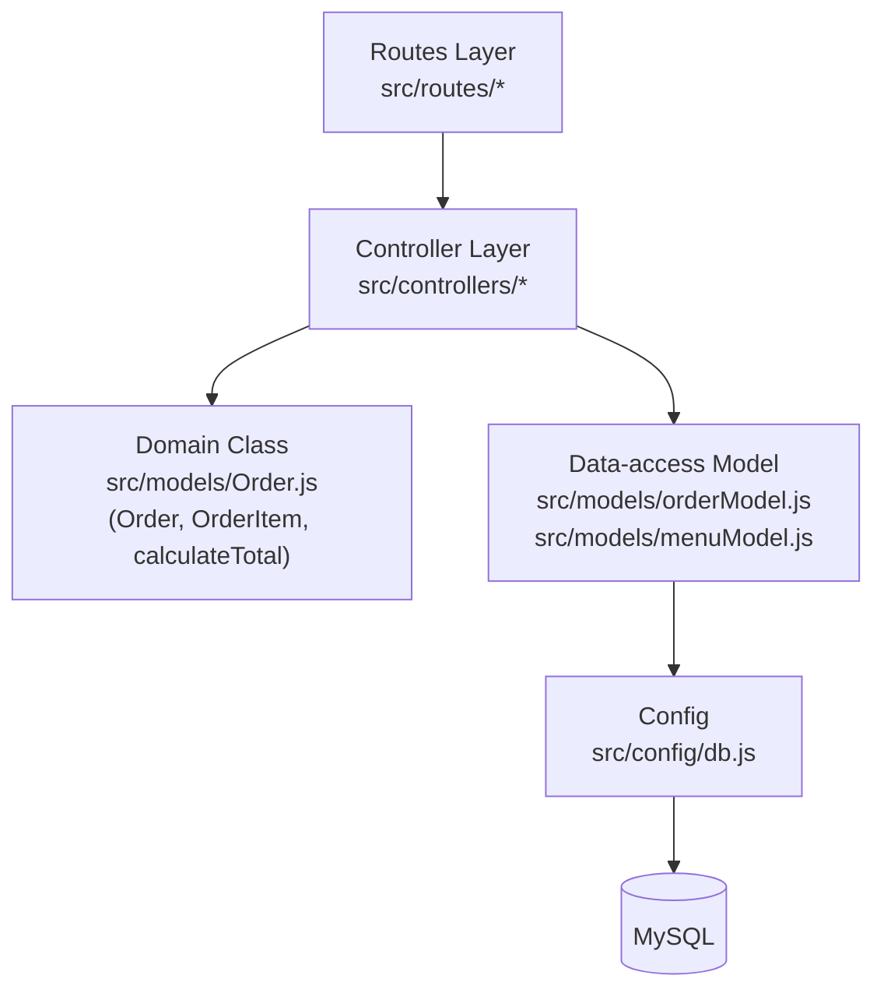
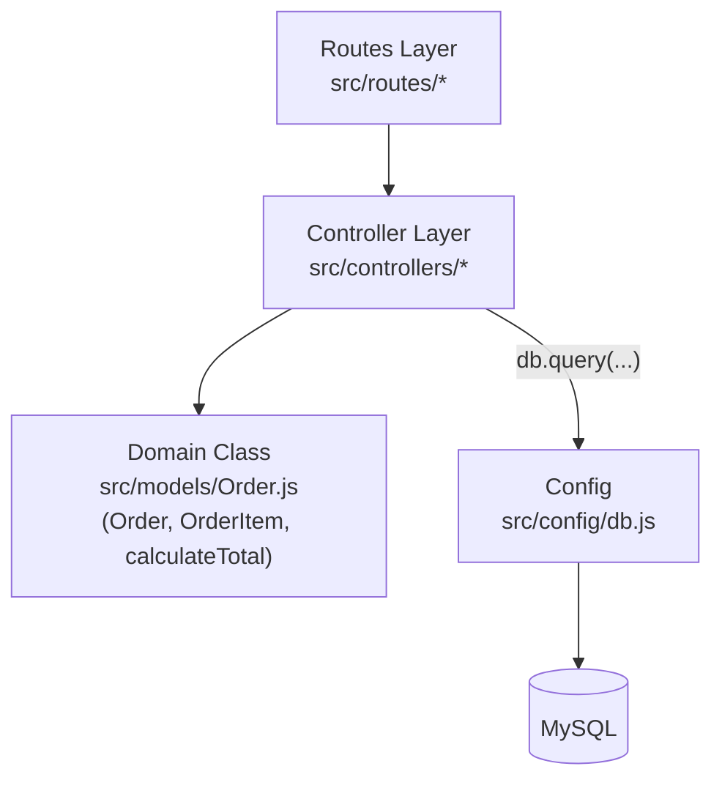

# สถาปัตยกรรมระบบร้านกาแฟ (Week 11 Workshop)

## 1. Physical View

Client Device: เป็นเครื่องที่ผู้ใช้เปิด Web Browser เพื่อเข้าใช้งานระบบ

Application Server: ใช้ Node.js และ Express รับคำขอจาก Browser ผ่าน Port 3000 แล้วประมวลผลตามการทำงานของระบบ

Database Server: ใช้ MySQL ฐานข้อมูล cafe_pos สำหรับจัดเก็บและเรียกใช้ข้อมูล โดยฝั่งแอปพลิเคชันเชื่อมต่อผ่าน mysql2 Connection Pool ตามข้อมูลในเอกสารเดิม

## 2. Development View (การแบ่ง Component/Module)

โครงสร้างโฟลเดอร์ใน `src/` ที่ตรวจกับ repo จริงของกลุ่ม: `routes/`, `controllers/`, `models/`, `config/db.js`

**เวอร์ชันที่ใช้: (ก) กลุ่มที่แยก Data-access Model แล้ว** (`models/` มีทั้ง `Order.js` และ `orderModel.js`/`menuModel.js`)

<!--
สลับเป็นเวอร์ชัน (ข) ถ้ากลุ่มยังไม่ได้แยก Data-access Model
(Controller เรียก db.query ตรง แต่มี Order.js ตาม wk06)
ให้ลบ diagram (ก) ด้านบน แล้วใช้ diagram นี้แทน:

**ข้อจำกัดที่ทราบ (Known Limitation):** endpoint `createOrder` ยังไม่มี database transaction ครอบ flow การตัดสต็อก ดังนั้นหากขั้นตอนใดล้มเหลวกลางทาง ข้อมูลสต็อกอาจไม่สอดคล้องกับคำสั่งซื้อ diagram นี้จึงไม่ควรถูกตีความว่าการตัดสต็อกปลอดภัยครบถ้วน (ข้อจำกัดนี้เกี่ยวกับ endpoint สั่งซื้อเท่านั้น ไม่เกี่ยวกับ CRUD เมนู)

**ตรวจความสอดคล้องกับ repo:**
- [ ] ทุกโฟลเดอร์/ไฟล์ใน diagram มีอยู่จริงใน `src/`
- [ ] ไฟล์ทุกชนิดใน `src/models/` ปรากฏใน diagram ครบ
- [ ] `src/config/db.js` ตรงกับลูกศรไป MySQL
- [ ] Physical View ตรงกับจำนวนเครื่องที่ใช้จริง

## 3. สรุปสถาปัตยกรรม

### 3. สรุปสถาปัตยกรรมของระบบ

กลุ่มเราเลือกใช้สถาปัตยกรรมแบบ Monolithic + Layered โดยใช้ Node.js และ Express สำหรับฝั่งเซิร์ฟเวอร์ และ MySQL ฐานข้อมูล `cafe_pos` ตามข้อมูลที่กำหนดไว้ในเอกสารโครงการ ตั้งแต่สัปดาห์ที่ 5 มีการวางโครงสร้างแบ่งเป็น Routes, Controllers และ Models เพื่อแยกหน้าที่การทำงานให้ชัดเจน โดยใน Repository ที่ตรวจพบมีไฟล์ `model/menuModel.js` สำหรับจัดการข้อมูลเมนู การใช้สถาปัตยกรรมนี้ช่วยให้โครงสร้างเข้าใจง่ายและเหมาะกับการพัฒนาโครงงานของกลุ่ม อย่างไรก็ตาม ไฟล์ของทุก Layer ยังไม่ได้รับการยืนยันว่ามีอยู่ครบใน Repository ปัจจุบัน
